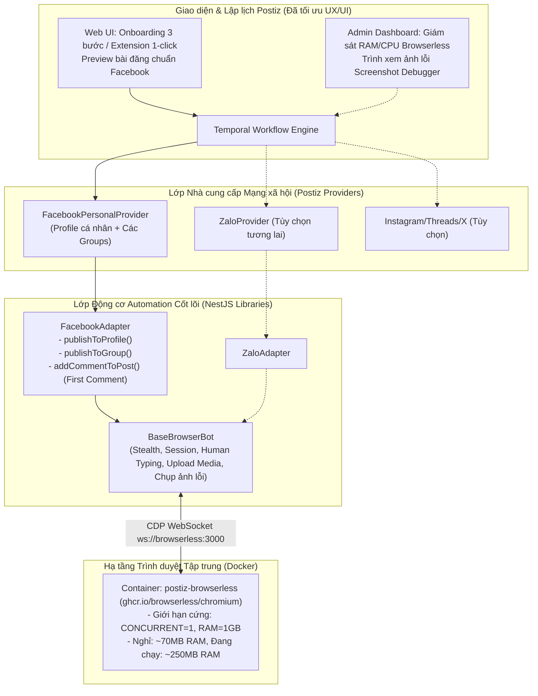

# Master Plan: Tự động hóa Trình duyệt Đa Nền tảng (Universal Browser Automation) cho Postiz

> **Mục tiêu:** Xây dựng bộ khung tự động hóa trình duyệt (Browser Automation Framework) hợp nhất trong Postiz bằng `puppeteer-core` + `browserless/chromium`, giải quyết bài toán đăng bài lên **Facebook Personal Profile**, **Facebook Groups** và sẵn sàng mở rộng sang **Zalo**, **Instagram Personal**, **Threads**, **X (Twitter)**; đồng thời thiết kế trải nghiệm UX/UI hoàn chỉnh cho cả **Người dùng cuối (End-User)** và **Người quản trị (Administrator)**.

---

## 1. Khảo sát & Đánh giá Nhu cầu

### 1.1. Thực trạng & Nhu cầu Mở rộng
* **Vấn đề ban đầu:** Meta đóng Groups API từ 04/2024; n8n + Puppeteer/Selenium ngốn quá nhiều RAM và phân mảnh quản trị.
* **Nhu cầu mở rộng của người dùng:**
  1. Đăng bài lên **Trang cá nhân Facebook (Personal Profile)** (Meta đã đóng API từ 2018).
  2. Đăng bài vào các **Hội nhóm Facebook (Facebook Groups)**.
  3. Chuẩn bị sẵn sàng kiến trúc cho các nền tảng khác: **Zalo** (gửi bài vào nhóm chat Zalo), **Instagram Cá nhân**, **Threads**, **X (Twitter)**.
  4. **Yêu cầu UX/UI:** Phải trực quan, dễ dùng cho người không chuyên kỹ thuật (End-User) và có công cụ theo dõi tài nguyên, chẩn đoán lỗi bằng ảnh chụp cho Quản trị viên (Admin).
* **Chiến lược giải pháp:**
  * Xây dựng **Lớp Cốt lõi Dùng chung (`BaseBrowserBot`)** kết nối tới container `browserless/chromium`.
  * Với Facebook: Người dùng chỉ cần dán Cookie một lần duy nhất (hoặc bấm kết nối 1-click qua Chrome Extension), Postiz sẽ hiển thị danh sách kênh gồm: **Trang cá nhân** và **Toàn bộ Hội nhóm đã tham gia** để người dùng tích chọn quản lý cùng lúc.

---

## 2. Kiến trúc Kỹ thuật Hợp nhất (Universal Architecture)

---

## 3. Cấu trúc Tài liệu Kế hoạch Chi tiết trong `/plan/fb-group-automation/`

Kế hoạch được module hóa thành các file chuyên biệt:

1. [`00-multi-platform-research.md`](file:///home/thinhpxp/Documents/postiz-app/plan/fb-group-automation/00-multi-platform-research.md): **Nghiên cứu mở rộng đa nền tảng**: Phân tích session, cơ chế DOM và tính khả thi của Facebook Profile, Zalo Web, Instagram, Threads, X.
2. [`01-browserless-infrastructure.md`](file:///home/thinhpxp/Documents/postiz-app/plan/fb-group-automation/01-browserless-infrastructure.md): **Phase 1 – Thiết lập hạ tầng Browserless**: Cấu hình Docker Compose cho `browserless/chromium`, thiết lập mạng nội bộ an toàn và giới hạn nghiêm ngặt CPU/RAM.
3. [`02-automation-core-script.md`](file:///home/thinhpxp/Documents/postiz-app/plan/fb-group-automation/02-automation-core-script.md): **Phase 2 – Xây dựng Lớp Cốt lõi `BaseBrowserBot` & `FacebookAdapter`**:
   - Thư viện nền tảng: `puppeteer-core` + `puppeteer-extra-plugin-stealth`.
   - Hỗ trợ cả **Đăng bài lên Profile cá nhân** VÀ **Đăng bài vào Groups**.
   - Cơ chế giả lập gõ phím người thật, upload media, nhận diện checkpoint và tự chụp ảnh màn hình debug.
4. [`03-backend-provider-integration.md`](file:///home/thinhpxp/Documents/postiz-app/plan/fb-group-automation/03-backend-provider-integration.md): **Phase 3 – Tích hợp Provider NestJS**:
   - Triển khai `FacebookPersonalProvider` (đại diện tài khoản Facebook cá nhân).
   - Form `customFields` nhập Cookies 1 lần.
   - Luồng `isBetweenSteps`: Tự động nạp đồng thời **Trang cá nhân** và **Danh sách Group** để người dùng tích chọn channel.
5. [`04-ux-ui-design-and-management.md`](file:///home/thinhpxp/Documents/postiz-app/plan/fb-group-automation/04-ux-ui-design-and-management.md): **Phase 4 – Bản thiết kế UX/UI cho End-User & Administrator**:
   - **End-User UX:** Kết nối 1-click qua Chrome Extension hoặc hướng dẫn 3 bước trực quan; phân biệt rõ huy hiệu Profile vs Group; Preview bài viết chuẩn Facebook; Bổ sung trạng thái "Chờ duyệt" (Pending Approval) trên Lịch.
   - **Admin UX:** Dashboard theo dõi CPU/RAM Browserless; Trình xem ảnh lỗi (Screenshot Debugger); Cài đặt giới hạn an toàn chống khóa nick (Rate Limiting) & Mã hóa cookie AES-256.
6. [`04-frontend-channel-ui.md`](file:///home/thinhpxp/Documents/postiz-app/plan/fb-group-automation/04-frontend-channel-ui.md): **Phase 4.1 – Triển khai Kỹ thuật Frontend Next.js**:
   - Bổ sung icon nhận diện, đăng ký Provider vào bộ soạn thảo `show.all.providers.tsx`.
7. [`05-testing-safety-and-deployment.md`](file:///home/thinhpxp/Documents/postiz-app/plan/fb-group-automation/05-testing-safety-and-deployment.md): **Phase 5 – Kiểm thử An toàn & Đóng gói Triển khai**:
   - Ma trận test an toàn (Tài khoản phụ -> Profile kín / Nhóm kín).
   - Quy trình build Docker image và cập nhật lên máy chủ `post.thinhpxp.io.vn`.

---

## 4. Bảng So sánh Năng lực Hệ thống

| Tiêu chí | Hệ thống Cũ (Postiz + n8n) | Hệ thống Mới (Postiz + Universal Browser Engine) |
| :--- | :--- | :--- |
| **Đăng Fanpage Facebook** | Qua Graph API của Postiz | Qua Graph API của Postiz (giữ nguyên) |
| **Đăng Facebook Groups** | Chạy kịch bản Puppeteer trên n8n | Đăng trực tiếp qua Browserless tích hợp trong Postiz |
| **Đăng Profile cá nhân** | Chưa có hoặc phải tạo thêm flow n8n | **Tích hợp sẵn** chung 1 tài khoản trong Postiz |
| **Bình luận đầu tiên (First Comment / Link dưới comment)** | Phải viết thêm node/kịch bản phức tạp trên n8n | **Hỗ trợ mặc định:** Tự động đăng comment ngay sau bài chính |
| **Mở rộng Zalo / Threads / X** | Phải viết thêm nhiều workflow n8n cồng kềnh | Chỉ cần thêm 1 Adapter kế thừa `BaseBrowserBot` |
| **Trải nghiệm nạp tài khoản (UX)** | Phải vào n8n sửa code workflow | **Giao diện web trực quan:** Hướng dẫn 3 bước hoặc Extension 1-click |
| **Chẩn đoán lỗi (Admin)** | Vào terminal soi log console | **Trình xem ảnh lỗi (Screenshot Debugger)** chụp màn hình thật của Facebook |
| **Tiêu thụ RAM máy chủ** | Tốn thêm **350MB – 600MB** cho n8n | Browserless rảnh chỉ tốn **~70MB RAM**, tự giải phóng |
