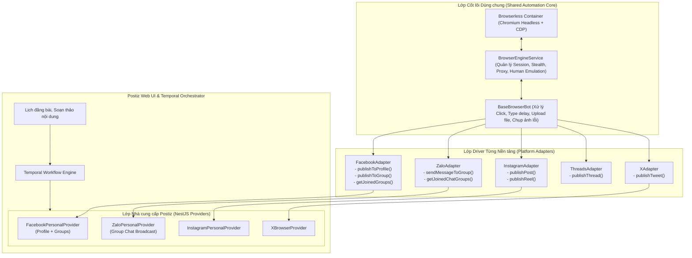

# Nghiên cứu Mở rộng: Tự động hóa Đa Nền tảng (Facebook Profile, Zalo, Instagram, Threads, X)

> **Mục tiêu:** Đánh giá tính khả thi, phân tích cơ chế xác thực (Session/Cookie), luồng tương tác DOM và các rủi ro kỹ thuật khi mở rộng hạ tầng Browser Automation từ Facebook Group sang **Facebook Profile cá nhân** và **các nền tảng khác** (Zalo, Instagram, Threads, X/Twitter).

---

## 1. Nhu cầu & Bối cảnh Tổng quan

Trong quản lý mạng xã hội, rất nhiều nền tảng hoặc tính năng quan trọng **không có API chính thức** hoặc **bị hạn chế rất ngặt nghèo**:

| Nền tảng | Trạng thái API chính thức | Lý do phải dùng Browser Automation |
| :--- | :--- | :--- |
| **Facebook Personal Profile** | Bị Meta đóng hoàn toàn từ năm 2018 (thu hồi quyền `publish_actions`). | Đăng bài lên dòng thời gian (Wall/Timeline) của chính tài khoản cá nhân. |
| **Facebook Groups** | Bị Meta đóng vĩnh viễn từ tháng 04/2024 (thu hồi `publish_to_groups`). | Đăng bài vào các cộng đồng/hội nhóm. |
| **Zalo (Cá nhân & Nhóm)** | Zalo chỉ có Zalo OA (Official Account) trả phí cho doanh nghiệp; **không có bất kỳ API nào** cho tài khoản cá nhân. | Đăng bài nhật ký hoặc gửi tin bài vào các nhóm Zalo bán hàng / nội bộ. |
| **Instagram Personal** | API chính thức bắt buộc phải chuyển sang tài khoản Doanh nghiệp/Creator và liên kết Fanpage. | Đăng ảnh/video lên tài khoản Instagram cá nhân thông thường. |
| **Threads (Meta)** | API chính thức đã có nhưng bắt buộc phải đăng ký ứng dụng Meta phức tạp. | Đăng bài chuỗi (thread) nhanh bằng tài khoản Instagram đã có. |
| **X (Twitter)** | X tính phí API rất đắt ($100 – $200/tháng cho gói Basic với giới hạn rất thấp). | Đăng tweet miễn phí không phụ thuộc vào gói cước đắt đỏ của X. |

---

## 2. Chi tiết Nghiên cứu Từng Nền tảng

---

### 2.1. Facebook Personal Profile (Trang cá nhân Facebook)

* **Mức độ khả thi:** ⭐⭐⭐⭐⭐ (Rất cao - Dùng chung 100% hạ tầng với Facebook Group)
* **Cơ chế Xác thực:**
  * Dùng chung chính xác bộ cookie của Facebook: `c_user`, `xs`, `datr`, `sb`, `fr`.
  * Khi người dùng nhập Cookie Facebook vào Postiz, hệ thống có thể quản lý **đồng thời cả Profile cá nhân và các Groups** của tài khoản đó mà không cần đăng nhập lại.
* **Luồng tương tác DOM:**
  1. Điều hướng: `https://www.facebook.com/me` hoặc trang chủ `https://www.facebook.com/`.
  2. Bấm vào ô: `[role="button"][aria-label*="Bạn đang nghĩ gì"], [role="button"][aria-label*="What's on your mind"]`.
  3. Nhập text: Gõ vào `[role="dialog"] [role="textbox"][contenteditable="true"]`.
  4. Đính kèm media: Upload qua `input[type="file"][accept*="image"]`.
  5. Đối tượng hiển thị (Audience): Có thể chọn "Công khai" (Public) hoặc "Bạn bè" (Friends).
  6. Bấm nút: `[role="dialog"] [aria-label="Đăng"]` hoặc `[aria-label="Post"]`.
* **Trải nghiệm UX trên Postiz:**
  * Khi kết nối tài khoản Facebook cá nhân, Postiz hiển thị danh sách kênh chọn (`isBetweenSteps`):
    * ☑️ **Trang cá nhân (Personal Profile)**
    * ☑️ **Nhóm: Cộng đồng Công nghệ**
    * ☑️ **Nhóm: Hội Marketing**
  * Người dùng có thể chọn 1 hoặc tất cả để đưa vào danh sách Channels của Postiz.

---

### 2.2. Zalo Web & Zalo Groups (Zalo Cá nhân)

* **Mức độ khả thi:** ⭐⭐⭐⭐ (Khả thi tốt qua Zalo Web)
* **Cơ chế Xác thực:**
  * Zalo hoạt động trên nền tảng web tại: `https://chat.zalo.me/`.
  * Cookies/Session Zalo gồm: `zpw_sek`, `zpw_env`, và dữ liệu `localStorage` (phiên đăng nhập định danh thiết bị).
  * Cách lấy session: Quét mã QR một lần trên giao diện web hoặc dán cookie/storageState.
* **Khả năng tự động hóa:**
  1. **Nhật ký Zalo (Feed):** Zalo Web bản hiện tại chủ yếu tập trung vào nhắn tin (Chat) và nhóm chat; giao diện Nhật ký chỉ hiển thị đầy đủ trên ứng dụng di động.
  2. **Gửi tin bài vào Nhóm Zalo (Group Broadcasting):**
     * Đây là nhu cầu cực lớn tại Việt Nam (bắn bài viết, thông báo, ảnh sản phẩm vào hàng loạt nhóm chat Zalo).
     * Luồng: Tìm kiếm tên nhóm -> Click mở khung chat -> Gõ nội dung bài viết -> Gửi kèm ảnh -> Bấm Send.
* **Lưu ý kỹ thuật:** Zalo kiểm tra thiết bị qua Web Cryptography; khi dùng với Browserless cần lưu trữ toàn bộ `storageState` (Cookies + LocalStorage) để không bị văng phiên.

---

### 2.3. Instagram Web (Tài khoản Cá nhân)

* **Mức độ khả thi:** ⭐⭐⭐⭐ (Khả thi cao)
* **Cơ chế Xác thực:**
  * Cookies Instagram: `sessionid`, `ds_user_id`, `csrftoken`, `mid`.
* **Luồng tương tác DOM:**
  1. Điều hướng: `https://www.instagram.com/`.
  2. Bấm nút tạo bài viết: Selector `svg[aria-label="Bài viết mới"]` hoặc `[aria-label="New post"]`.
  3. Kéo thả / Upload ảnh/video qua `input[type="file"]`.
  4. Chọn tỷ lệ khung hình (1:1, 4:5, 16:9), bấm Tiếp tục (Next).
  5. Viết caption vào ô `div[aria-label="Viết chú thích..."]`.
  6. Bấm "Chia sẻ" (Share).
* **Lợi ích:** Đăng được ảnh/Reels lên Instagram cá nhân mà không cần fanpage Facebook hay tài khoản doanh nghiệp.

---

### 2.4. Threads (threads.net)

* **Mức độ khả thi:** ⭐⭐⭐⭐ (Khả thi cao, giao diện rất nhẹ)
* **Cơ chế Xác thực:**
  * Threads dùng chung hệ sinh thái xác thực với Instagram (cùng `sessionid` hoặc liên kết trực tiếp).
* **Luồng tương tác DOM:**
  1. Điều hướng: `https://www.threads.net/`.
  2. Bấm vào khung "Bắt đầu chuỗi bài..." (Start a thread).
  3. Gõ text, đính kèm ảnh qua nút đính kèm.
  4. Bấm nút "Đăng" (Post).
  5. Giao diện Threads trên nền web rất gọn và tốc độ tải DOM nhanh hơn Facebook rất nhiều.

---

### 2.5. X / Twitter (Automation không mất phí API)

* **Mức độ khả thi:** ⭐⭐⭐⭐⭐ (Rất phổ biến trong cộng đồng mã nguồn mở)
* **Cơ chế Xác thực:**
  * Cookies: `auth_token`, `ct0`.
* **Luồng tương tác DOM:**
  1. Điều hướng `https://x.com/compose/post`.
  2. Nhập nội dung vào `[data-testid="tweetTextarea_0"]`.
  3. Upload ảnh qua `input[data-testid="fileInput"]`.
  4. Bấm `[data-testid="tweetButton"]`.
* **Lợi ích:** Tiết kiệm \$100/tháng phí API của Twitter cho người dùng cá nhân/tự lưu trữ (self-hosted).

---

## 3. Kiến trúc Tổng thể: Bộ Khung Tự động hóa Trình duyệt Đa Nền tảng (Universal Browser Automation Framework)

Để tránh việc mỗi nền tảng lại phải viết lại từ đầu kịch bản trình duyệt, hệ thống được thiết kế theo mô hình **Core Engine & Driver Pattern**:

---

## 4. Lộ trình Triển khai Đề xuất

1. **Giai đoạn Trọng tâm (Ưu tiên số 1):**
   * Hoàn thiện kiến trúc `BaseBrowserBot` và `FacebookAdapter`.
   * Hỗ trợ **cả Facebook Personal Profile VÀ Facebook Groups** trong một Provider duy nhất (`FacebookPersonalProvider`). Người dùng chỉ cần nhập cookie 1 lần là quản lý được cả Trang cá nhân lẫn các Hội nhóm.
2. **Giai đoạn Mở rộng (Ưu tiên tiếp theo):**
   * Kế thừa `BaseBrowserBot` để bổ sung thêm:
     * **Zalo Group Broadcast** (gửi tin bài vào các nhóm Zalo bán hàng/cộng đồng).
     * **Threads Web / Instagram Personal** (nếu người dùng có nhu cầu mở rộng tệp khán giả).

