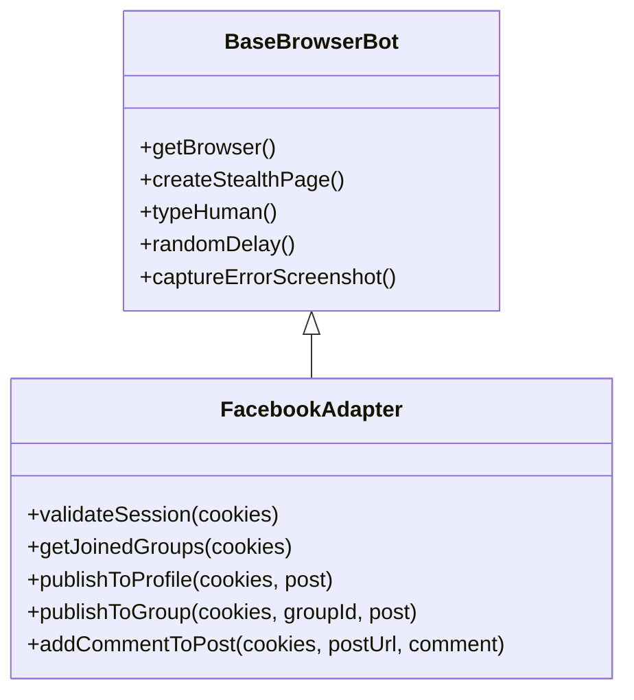

# Phase 2: Xây dựng Động cơ Automation Cốt lõi (`BaseBrowserBot` & `FacebookAdapter`)

> **Mục tiêu:** Xây dựng kiến trúc module gồm: lớp cơ sở `BaseBrowserBot` (dùng chung cho mọi nền tảng tự động hóa) và lớp chuyên biệt `FacebookAdapter` (xử lý cả đăng bài lên **Trang cá nhân / Personal Profile** lẫn **Hội nhóm / Groups**).

---

## 1. Cài đặt Thư viện Nền tảng

Chạy lệnh cài đặt vào thư mục `libraries/nestjs-libraries`:
```bash
pnpm --filter @gitroom/nestjs-libraries add puppeteer-core puppeteer-extra puppeteer-extra-plugin-stealth
```

---

## 2. Thiết kế Lớp Cơ sở Dùng chung: `BaseBrowserBot`

Tạo file:
[`libraries/nestjs-libraries/src/integrations/social/browser-bot/base-browser.bot.ts`](file:///home/thinhpxp/Documents/postiz-app/libraries/nestjs-libraries/src/integrations/social/browser-bot/base-browser.bot.ts)

Lớp này đóng gói toàn bộ logic hạ tầng trình duyệt:
- Kết nối tới `browserless/chromium` qua WebSocket.
- Tự động kích hoạt Stealth Plugin (che giấu cờ bot, giả lập WebGL, platform, audio fingerprint).
- Quản lý viewport, User-Agent chuẩn desktop.
- Nạp cookie an toàn.
- Giả lập hành vi người thật:
  - `typeHuman(selector, text)`: Gõ phím với khoảng cách ngẫu nhiên 25ms – 65ms giữa các ký tự.
  - `randomDelay(min, max)`: Tạm dừng ngẫu nhiên giữa các thao tác bấm chuột.
- Chụp ảnh màn hình lưu vào `/uploads/debug/` khi xảy ra lỗi để phục vụ chẩn đoán sự cố.
- **Giải phóng tài nguyên tuyệt đối:** Đảm bảo luôn `close()` tab và `disconnect()` WebSocket trong khối `finally`.

```typescript
export abstract class BaseBrowserBot {
  protected wsUrl = process.env.BROWSERLESS_WS_URL || 'ws://browserless:3000';

  protected async getBrowser() {
    return puppeteer.connect({
      browserWSEndpoint: this.wsUrl,
    });
  }

  protected async createStealthPage(browser: any, cookies: any[]) {
    const page = await browser.newPage();
    await page.setViewport({ width: 1280, height: 800 });
    await page.setUserAgent(
      'Mozilla/5.0 (Windows NT 10.0; Win64; x64) AppleWebKit/537.36 (KHTML, like Gecko) Chrome/126.0.0.0 Safari/537.36'
    );
    if (cookies?.length) {
      await page.setCookie(...cookies);
    }
    return page;
  }

  protected async typeHuman(page: any, selector: string, text: string) {
    await page.waitForSelector(selector, { visible: true, timeout: 15000 });
    await page.focus(selector);
    for (const char of text) {
      await page.keyboard.type(char);
      await new Promise((r) => setTimeout(r, Math.floor(Math.random() * 40) + 25));
    }
  }
}
```

---

## 3. Lớp Xử lý Chuyên biệt: `FacebookAdapter`

Tạo file:
[`libraries/nestjs-libraries/src/integrations/social/browser-bot/facebook.adapter.ts`](file:///home/thinhpxp/Documents/postiz-app/libraries/nestjs-libraries/src/integrations/social/browser-bot/facebook.adapter.ts)

Lớp này kế thừa `BaseBrowserBot` và cung cấp các hàm nghiệp vụ Facebook:



### 3.1. Xác thực & Nhận diện Tài khoản (`validateSession`)
1. Điều hướng: `https://www.facebook.com/me`
2. Kiểm tra nếu URL chuyển hướng về `/checkpoint/` -> Ném ngoại lệ báo Checkpoint.
3. Nếu thành công: Trích xuất `c_user`, Họ tên hiển thị, Avatar đại diện.

### 3.2. Lấy Danh sách Nhóm đã Tham gia (`getJoinedGroups`)
1. Điều hướng `https://www.facebook.com/groups/joins/`.
2. Trích xuất danh sách `{ id, name, picture }` của toàn bộ nhóm mà tài khoản là thành viên.

### 3.3. Đăng bài lên Trang Cá nhân (`publishToProfile`)
1. Điều hướng `https://www.facebook.com/me`.
2. Bấm vào khung tạo bài viết:
   `[role="button"][aria-label*="Bạn đang nghĩ gì"], [role="button"][aria-label*="What's on your mind"]`.
3. Gõ nội dung bài viết bằng `typeHuman` vào `[role="dialog"] [role="textbox"]`.
4. Nếu có media: Upload qua input file `[role="dialog"] input[type="file"][accept*="image"]`.
5. Đợi upload hoàn tất -> Bấm nút `[role="dialog"] [aria-label="Đăng"]`.
6. Đợi dialog biến mất -> Trả về kết quả thành công kèm liên kết bài viết.

### 3.4. Đăng bài vào Hội nhóm (`publishToGroup`)
1. Điều hướng trực tiếp: `https://www.facebook.com/groups/${groupId}`.
2. Bấm ô tạo bài viết:
   `[role="button"][aria-label*="Bạn viết gì đi"], [role="button"][aria-label*="Write something"]`.
3. Gõ nội dung bằng `typeHuman`.
4. Upload file ảnh/video nếu có.
5. Bấm nút Đăng: `[role="dialog"] [aria-label="Đăng"]`.
6. Nhận diện phản hồi:
   - Bài viết đăng công khai ngay lập tức -> Đánh dấu `status: 'completed'`.
   - Bài viết cần Admin duyệt ("Bài viết đang chờ phê duyệt") -> Đánh dấu `status: 'pending'`.

### 3.5. Tự động Bình luận Dưới Bài viết (First Comment Automation - `addCommentToPost`)
Chiến thuật phổ biến trong Marketing là để đường link ở comment đầu tiên ("Link dưới bình luận") nhằm tránh thuật toán Facebook bóp tương tác (reach penalty) của bài viết chính:
1. Nhận `postUrl` (hoặc URL của bài vừa đăng).
2. Điều hướng thẳng tới bài viết `page.goto(postUrl)`.
3. Tìm ô bình luận của bài viết:
   `[aria-label*="Viết bình luận"], [aria-label*="Write a comment"], [role="textbox"][contenteditable="true"]`.
4. Gõ nội dung bình luận bằng `typeHuman` (hỗ trợ chèn link, hashtag, kêu gọi hành động).
5. Nhấn phím `Enter` (hoặc bấm icon gửi bình luận).
6. Đợi bình luận xuất hiện thành công trong danh sách comment.
7. Đóng tab và trả về kết quả cho Postiz.
