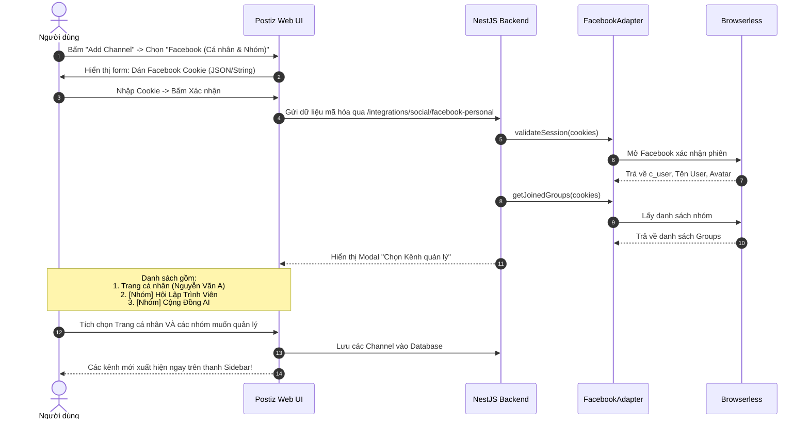

# Phase 4: Tích hợp Giao diện Người dùng Đa Kênh (Frontend Next.js)

> **Mục tiêu:** Bổ sung icon nhận diện cho `facebook-personal`, đăng ký vào bảng điều khiển soạn bài đa kênh (New Launch), và tối ưu giao diện chọn kênh giữa Trang cá nhân và Hội nhóm.

---

## 1. Icon Nhận diện Nền tảng

1. **Vị trí icon:**
   [`apps/frontend/public/icons/platforms/facebook-personal.png`](file:///home/thinhpxp/Documents/postiz-app/apps/frontend/public/icons/platforms/)
2. **Hình ảnh:**
   - Dùng icon Facebook có biểu tượng cá nhân / profile (hoặc dùng bản copy của `facebook.png` đổi tên thành `facebook-personal.png`).

---

## 2. Đăng ký Provider vào Trình soạn thảo (`show.all.providers.tsx`)

Mở file:
[`apps/frontend/src/components/new-launch/providers/show.all.providers.tsx`](file:///home/thinhpxp/Documents/postiz-app/apps/frontend/src/components/new-launch/providers/show.all.providers.tsx)

```typescript
import FacebookProvider from '@gitroom/frontend/components/new-launch/providers/facebook/facebook.provider';

export const Providers = [
  // ...
  {
    identifier: 'facebook',
    component: FacebookProvider, // Facebook Page chính quy
  },
  {
    identifier: 'facebook-personal',
    component: FacebookProvider, // Facebook Cá nhân (Profile & Groups)
  },
  // ...
];
```

---

## 3. Trải nghiệm Người dùng (UX Flow) Hoàn chỉnh



---

## 4. Quản lý Lịch Đăng Đa Nền tảng
- Trong màn hình Lịch (Calendar) hoặc Tạo bài mới (New Launch):
  - Người dùng có thể tích chọn đồng thời:
    - 🔵 `Facebook Page: Công ty XYZ` (chạy qua Meta Graph API)
    - 👤 `FB Profile: Nguyễn Văn A` (chạy qua Browserless)
    - 👥 `FB Group: Hội Khởi Nghiệp` (chạy qua Browserless)
    - 🐦 `X (Twitter)`
  - Chỉ với 1 lần bấm **Schedule**, Temporal sẽ tự động điều phối bài viết đến đúng từng kênh mà người dùng đã chọn.
