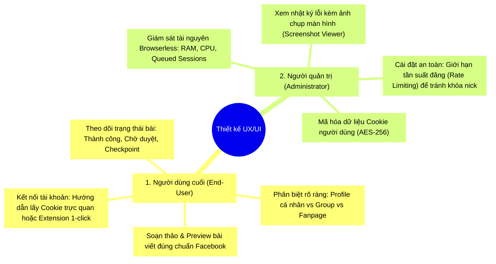

# Phase 4: Thiết kế Trải nghiệm Người dùng (UX) & Giao diện (UI) cho End-User và Quản trị viên (Admin)

> **Mục tiêu:** Xây dựng giải pháp UX/UI hoàn chỉnh, thân thiện và dễ sử dụng cho **Người dùng cuối (End-User / Content Creator)** khi kết nối tài khoản, chọn kênh và lên lịch; đồng thời cung cấp công cụ giám sát, chẩn đoán lỗi và cài đặt an toàn cho **Người quản trị hệ thống (System Administrator)**.

---

## 1. Phân tích Góc nhìn & Nhu cầu (Personas)



---

## 2. Thiết kế UX/UI cho Người dùng cuối (End-User)

### 2.1. Luồng Kết nối Tài khoản Facebook Cá nhân (Onboarding & Connect Modal)
* **Vấn đề thực tế:** Người dùng thông thường không biết "Cookie" hay JSON là gì. Nếu chỉ để 1 ô input thô sẽ gây khó khăn và tỉ lệ kết nối thất bại cao.
* **Giải pháp UI:** Thiết kế modal kết nối 2 phương thức:
  1. **Cách 1: Tự động qua Chrome Extension (Khuyên dùng - 1 Click):**
     - Postiz đã có sẵn cơ chế `isChromeExtension = true` (tương tự kênh Skool).
     - Người dùng chỉ cần mở tiện ích mở rộng Postiz trên Chrome -> Bấm nút **"Kết nối Facebook"** -> Extension tự động lấy session cookies của tab Facebook đang mở gửi về Postiz. Người dùng không cần thao tác copy/paste.
  2. **Cách 2: Nhập Cookie thủ công (Kèm hướng dẫn trực quan 3 bước):**
     - Bước 1: Cài tiện ích [Cookie-Editor](https://cookie-editor.com/) (có nút bấm mở link Chrome Web Store).
     - Bước 2: Đăng nhập `facebook.com` -> Mở Cookie-Editor -> Bấm nút **Export -> Export as JSON**.
     - Bước 3: Dán vào ô nhập liệu -> Bấm nút **"Kiểm tra & Kết nối"**.
* **Phản hồi lỗi thời gian thực (Real-time Feedback):**
  - Khi người dùng dán cookie và bấm kết nối: Hiển thị hiệu ứng loading *"Đang kiểm tra phiên đăng nhập trên Facebook..."*.
  - Nếu thành công: Hiển thị ngay Avatar, Tên Facebook và dấu tích xanh ✅.
  - Nếu tài khoản dính Checkpoint: Báo lỗi tiếng Việt rõ ràng: *"Tài khoản của bạn đang bị Facebook yêu cầu xác minh danh tính. Vui lòng mở Facebook trên điện thoại/máy tính để mở khóa trước khi kết nối"*.

---

### 2.2. Giao diện Chọn Kênh Quản lý (`isBetweenSteps` Selection Modal)
Sau khi kết nối Cookie thành công, Postiz hiển thị popup danh sách các kênh con để người dùng tick chọn:

```
+-----------------------------------------------------------------------+
|  Chọn các kênh bạn muốn đưa vào Postiz                                |
|  Tài khoản: Nguyễn Văn A (ID: 100012345678)                           |
+-----------------------------------------------------------------------+
|  [Tìm kiếm nhóm...]                                                   |
|                                                                       |
|  [v] 👤 TRANG CÁ NHÂN                                                 |
|      Trang cá nhân (Nguyễn Văn A)                      [Mặc định]     |
|                                                                       |
|  --- CÁC HỘI NHÓM ĐÃ THAM GIA (12 nhóm) ----------------------------- |
|  [v] 👥 Cộng Đồng Lập Trình Viên Việt Nam (320K thành viên)           |
|  [v] 👥 Hội Marketing & AI Automation (85K thành viên)                |
|  [ ] 👥 Nhóm Bất Động Sản Hà Nội (12K thành viên)                     |
|  [ ] 👥 Hội Mua Bán Xe Cũ (45K thành viên)                            |
|                                                                       |
|  [ Nạp lại danh sách nhóm (Refresh) ]                                 |
+-----------------------------------------------------------------------+
|                                    [ Hủy ]   [ Thêm 3 kênh đã chọn ]  |
+-----------------------------------------------------------------------+
```

* **Tính năng:**
  * Có ô tìm kiếm nhanh (filter) nếu người dùng tham gia hàng chục nhóm.
  * Có nút **"Nạp lại danh sách nhóm"** để cập nhật nếu người dùng vừa mới tham gia thêm nhóm mới trên Facebook.

---

### 2.3. Trải nghiệm Soạn thảo Đa Kênh & Nhận diện Kênh
* **Nhãn kênh (Badges) trên thanh chọn kênh:**
  * 🔵 `[Fanpage] Postiz App` (Đăng qua Meta Graph API)
  * 👤 `[Profile] Nguyễn Văn A` (Đăng qua Browserless lên dòng thời gian cá nhân)
  * 👥 `[Group] Cộng Đồng Lập Trình` (Đăng qua Browserless vào nhóm)
* **Khung xem trước bài viết (Post Preview):**
  * Tái sử dụng component preview chuẩn của Facebook (Avatar người đăng, Tên người dùng/Nhóm, Dấu thời gian, Nội dung text, Grid bố cục hiển thị hình ảnh).
* **Cài đặt riêng cho từng kênh (Channel Settings):**
  * Với Trang cá nhân: Cho phép chọn **Quyền riêng tư** (Công khai / Bạn bè / Chỉ mình tôi).
  * Với Hội nhóm: Có tùy chọn **"Đăng ẩn danh"** (nếu nhóm cho phép).

---

### 2.4. Trạng thái Bài viết trên Lịch (Calendar Status UX)
Mở rộng các trạng thái trên giao diện Lịch để phù hợp với đặc thù của Facebook Group:

| Trạng thái UI | Màu sắc | Ý nghĩa | Hành động của người dùng |
| :--- | :--- | :--- | :--- |
| **Đã xuất bản (Published)** | 🟢 Xanh lá | Bài viết đã hiển thị công khai trên Profile/Nhóm | Bấm vào để xem link bài viết thật trên Facebook |
| **Chờ Admin duyệt (Pending Approval)** | 🟡 Vàng cam | Bài đã gửi vào nhóm thành công nhưng đang nằm trong hàng đợi duyệt của Quản trị viên nhóm | Hiển thị tooltip giải thích rõ; không tính là lỗi |
| **Lỗi (Error / Blocked)** | 🔴 Đỏ | Bị lỗi mạng, checkpoint hoặc bị Facebook chặn tính năng | Bấm vào để xem nguyên nhân chi tiết + ảnh chụp màn hình lúc bị chặn |
| **Cần cập nhật Cookie (Reconnect Needed)** | ⚠️ Biểu tượng cảnh báo vàng | Cookie hết hạn (sau 30–60 ngày) hoặc người dùng vừa đổi mật khẩu FB | Bấm vào để mở modal dán Cookie mới trong 10 giây |

---

## 3. Thiết kế UX/UI cho Người quản trị (Administrator)

Người quản trị chịu trách nhiệm vận hành hệ thống, theo dõi tài nguyên server và can thiệp khi có lỗi.

### 3.1. Bảng điều khiển Giám sát Hạ tầng Trình duyệt (Browserless Health & Resource Monitor)
Tích hợp một tab nhỏ trong menu Cài đặt Quản trị (`/settings/automation-monitor`):

```
+-----------------------------------------------------------------------+
|  Trạng thái Hạ tầng Browser Automation (Browserless)                  |
+-----------------------------------------------------------------------+
|  Trạng thái: [ ONLINE ] (v2.18.0 Chromium)    Uptime: 14 ngày 6 giờ   |
|                                                                       |
|  RAM sử dụng hiện tại:  [====------------------] 185 MB / 1024 MB     |
|  CPU đang dùng:         [=---------------------] 4.2%                 |
|  Phiên đang chạy:       1 / 1 (Max Concurrent)                        |
|  Hàng đợi hiện tại:     0 bài đang chờ                                |
|                                                                       |
|  [ Kiểm tra kết nối lại ]                  [ Tự động dọn dẹp cache ]  |
+-----------------------------------------------------------------------+
```

* Giúp Admin ngay lập tức biết được Browserless có bị nghẽn (overloaded) hay ngốn RAM server hay không mà không cần phải gõ lệnh terminal `docker stats`.

---

### 3.2. Trình Xem Lỗi Kèm Ảnh Chụp Màn hình (Screenshot Debugger)
Khi một bài đăng thất bại (do đổi giao diện, Facebook checkpoint, hoặc câu hỏi xác minh):
1. Bot tự động chụp lại ảnh màn hình trình duyệt tại thời điểm lỗi và lưu vào thư mục an toàn `/uploads/debug/errors/[post_id].png`.
2. Trên màn hình quản trị bài viết, Admin bấm vào nút **"Xem chi tiết lỗi"**:
   - Hiển thị pop-up chứa:
     - Thông báo lỗi kỹ thuật (Error message).
     - **Ảnh chụp màn hình thực tế của Facebook** lúc xảy ra sự cố.
   - *Lợi ích:* Admin nhìn vào ảnh là biết ngay lý do (ví dụ: thấy ảnh hiện thông báo "Bạn đã đăng quá nhiều bài trong ngày hôm nay" hoặc "Group yêu cầu trả lời 3 câu hỏi trước khi đăng").

---

### 3.3. Cài đặt Giới hạn An toàn & Chống Khóa Tài khoản (Safety & Rate Limiting Settings)
Cung cấp màn hình cấu hình cho Admin để bảo vệ toàn bộ tài khoản người dùng trong hệ thống:

* **Khoảng cách tối thiểu giữa 2 bài đăng cùng 1 tài khoản:** Mặc định: `180 giây` (3 phút).
* **Số lượng bài tối đa một tài khoản được đăng mỗi ngày:** Mặc định: `15 bài/ngày`.
* **Cơ chế chống spam (Jitter delay):** Tự động thêm độ trễ ngẫu nhiên từ 10 đến 45 giây trước khi bắt đầu kịch bản đăng.
* **Tự động tạm dừng (Auto-pause on Checkpoint):** Nếu phát hiện tài khoản bị checkpoint, hệ thống tự động gắn cờ `refreshNeeded: true` và tạm hoãn các bài viết tiếp theo của tài khoản đó để không tiếp tục gửi request gây khóa tài khoản vĩnh viễn.

---

### 3.4. Bảo mật Dữ liệu Phiên (Security & Data Protection)
* **Mã hóa Cookie ở trạng thái nghỉ (At-rest Encryption):**
  - Cookie của người dùng là thông tin nhạy cảm. Toàn bộ chuỗi cookie khi lưu vào database PostgreSQL (`Integration.token`) đều được mã hóa bằng thuật toán **AES-256-GCM** với khóa bảo mật `APP_SECRET` của hệ thống.
  - Người dùng hoặc nhân viên không có quyền xem ngược lại chuỗi cookie gốc dạng plain-text trên giao diện.

---

## 4. Tóm tắt Đóng góp UX/UI vào Sự Thành công của Dự án

| Tiêu chí | Trước cải tiến (n8n/Kịch bản rời) | Sau cải tiến (Postiz Integrated UX/UI) |
| :--- | :--- | :--- |
| **Trải nghiệm nạp tài khoản** | Phức tạp, phải sửa workflow code trên n8n | Có giao diện web trực quan, hỗ trợ Extension 1-click hoặc hướng dẫn 3 bước |
| **Phân biệt kênh** | Phải nhớ ID từng nhóm | Phân biệt rõ Profile vs Group bằng huy hiệu & avatar chuẩn |
| **Xem trước bài đăng** | Không có preview | Preview đầy đủ giao diện Facebook trước khi bấm Đăng |
| **Chẩn đoán sự cố** | Phải vào terminal soi console log | Có ảnh chụp màn hình lúc lỗi trực tiếp trên giao diện |
| **Kiểm soát rủi ro khóa nick** | Khó kiểm soát, dễ bị spam | Admin thiết lập được giới hạn bài đăng & giãn cách thời gian an toàn |

